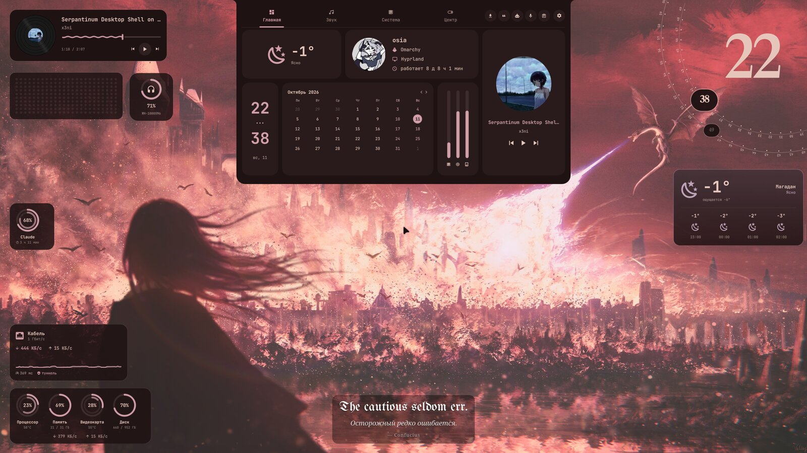

# TheNotch



Одна «чёлка» для всего в [Omarchy](https://omarchy.org) — замена встроенной оболочки: Dynamic Island на любой стороне экрана, пункт управления, обзор рабочих столов, виджеты на рабочем столе и окно настроек как «Параметры» Windows. Пока она включена, панель Omarchy спрятана.

Плагин `osia.thenotch`. Самодостаточный: всё, что ему нужно из других плагинов, лежит внутри (`vendor/`).

## Установка

```bash
git clone https://github.com/Oxisa/TheNotch.git && cd TheNotch && ./install.sh
```

`install.sh` ставит плагин, выключает встроенный сервис уведомлений Omarchy (TheNotch принимает их сам), проверяет необязательные программы и предлагает поставить недостающие, а в конце перечисляет всё, что TheNotch меняет вне своей папки. `./install.sh --check` — только отчёт, `./install.sh --uninstall` — откатить изменения (данные остаются).

Выключить: `omarchy plugin disable osia.thenotch` — панель Omarchy вернётся. TheNotch сам принимает уведомления, поэтому встроенный сервис уведомлений Omarchy (`omarchy.notifications`) при нём лучше держать выключенным.

## Как устроено

- **Закрытая чёлка** — только взгляд. Что слева и справа, вы расставляете сами перетаскиванием (Персонализация → Чёлка): рабочий стол, приложения стола, полка, погода, часы, раскладка, кто слушает микрофон и камеру (оранжевая и зелёная точки, при наведении — кто), «микрофон выключен». Живое — музыка (обложка и столбики в цвет обложки), загрузка с кольцом, таймер, помодоро — встаёт ближе к середине. Средняя кнопка мыши — выключить/включить микрофон, колесо над столом — листать столы. Перетащите файл или текст на чёлку — он ляжет на полку.
- **Открытая чёлка** — вкладки:
  - **Главная** — погода, профиль, календарь, ресурсы;
  - **Столы** — карта мониторов как они стоят: на каждом его стол с обоями и живыми окнами, полоска остальных столов, режим тайлинга (как везде, спираль, главное окно, лента, без тайлинга) одной кнопкой; окна перетаскиваются между столами;
  - **Система** — кольца видеокарты, процессора и памяти, сеть, диски и диспетчер задач в духе btop (нагрузка по ядрам, процессы по приложениям, «Завершить»);
  - **Центр** — пункт управления: сеть и Bluetooth (списки раскрываются на месте: подключить, забыть, настройки), переключатели, громкость и микрофон с выбором устройства, яркость мониторов (DDC), музыка, инструменты, уведомления.
- **Инструменты** открываются из «Центра» и возвращаются в него: загрузки, звук (эквалайзер, фокус, микрофон, текст песни), цитаты, агенты, диктофон, буфер обмена, скриншот, календарь, заметки, полка.
- **Полноэкранный обзор** — Super + `: столы монитора сверху, текущий крупно, перетаскивание окон на столы, ✕ и 📌 (закрепить окно поверх всех столов в углу).
- **Без тайлинга** — держите Super + Shift и тащите окно: появляются зоны (половины, трети, четверти, «главное + два», «широкий»), окно встаёт в зону.
- **Настройки** запоминают раздел и вкладку; разделы: Система (оболочка, уведомления, учётная запись, этот компьютер в духе fastfetch, авторы) · Сеть и интернет (подключение, Wi-Fi, кабель, трафик и частные сети, подробно) · Bluetooth и устройства (устройства, наушники Sony, мышь Logitech, камера, принтеры) · Дисплеи · Звук · Ввод (клавиатура, раскладки, курсоры — свои темы, импорт из .zip, «в цвет темы») · Персонализация (чёлка, темы, окна, обои, шрифты, виджеты, экран блокировки) · Рабочие столы · Конфиденциальность · Приложения · Инструменты (загрузки, Syncthing, KDE Connect) · Модули · Плагины Omarchy.
- **Один язык и одни шрифты** на всю оболочку: язык — в «Системе», шрифт интерфейса и шрифт виджетов — в «Персонализации → Шрифты» (системный, «Гоэтия» — готика для латиницы и Noto Serif для кириллицы, или любой установленный).
- **Окна Hyprland**: скругление, прозрачность, отступы, рамка, размытие; виджеты прячутся, когда окна закрывают 80 % монитора.
- **Цитаты**: изречения, сайты цитат, Библия, Сунь-цзы (китайский оригинал), хокку (японский оригинал), свои сайты с JSON — каждая категория включается отдельно.
- **Заметки** — стикеры с галочками; каждая копируется в `Документы/Заметки/<заголовок>.md`.

## Что встроено

`vendor/` — копии, чтобы TheNotch работал без других плагинов (подробно — [vendor/README.md](vendor/README.md)): SoundHub, Omaloader и Daily Quote (наши, живут и в [omarchy-backup-hub](https://github.com/Oxisa/omarchy-backup-hub) как отдельные плагины), сервис уведомлений (доработанная копия встроенного в Omarchy), видео-обои (Live Wallpaper), сборщик сетевых данных (Bananet), движок тем (Omapalette), бэкенд дисплеев (omarchy-display). Все — MIT.

## Программы, без которых часть работает не вся

Чёлка, настройки, виджеты и основные разделы работают на том, что уже есть в Omarchy. Отдельные функции используют системные программы, если они установлены, и честно говорят, если их нет:

| Функция | Программа |
|---|---|
| Сведения «Этот компьютер» | `fastfetch` |
| Яркость мониторов | `ddcutil` |
| Видео-обои, превью видео | `ffmpeg` (есть в Omarchy) |
| KDE Connect | `kcd` |
| Мышь Logitech | `solaar` |
| Наушники Sony | `mdrctl` (собирается кнопкой в «Наушниках») |
| Тема из цвета, обои в тон | `aether` |
| Принтеры в сети | `avahi`, CUPS (есть в Omarchy) |
| Syncthing | `syncthing` |
| Спектр музыки | `cava` |

## IPC

```bash
qs -p /usr/share/omarchy/shell ipc call osia.thenotch <команда>
```

`toggle`, `open <модуль>`, `close`, `settings [раздел]`, `layout`, `edge top|bottom|left|right`, `cycleEdge`, `bar on|off`, `flash <json>`, `micMute`, `pomodoro`, `pomodoroStop`, `overview`, `snapStart`, `snapEnd`, `state`, `debug`. Уведомления — цель `notifications`, видео-обои — `tenzin.live-wallpaper` (те же имена, что у исходных плагинов).

## Модули

Каждый раздел — папка в `modules/` со своим `Module.qml`. Как добавить свой: [modules/README.md](modules/README.md).

## Планы

- Свой док с окнами и закреплёнными приложениями.
- Канбан вместе с веб-сервисом на домашнем сервере.

## Лицензия

MIT. Вогнутые уголки чёлки (`Fillet.qml`) сделаны по образцу [skuthus/omanotch](https://github.com/skuthus/omanotch) (MIT). Авторы всего, что использовано или подсказало идеи, — в «Настройки → Система → Авторы».
